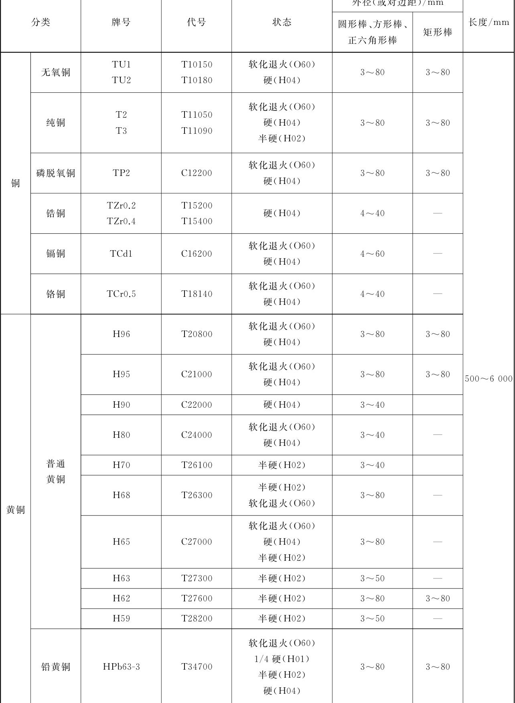
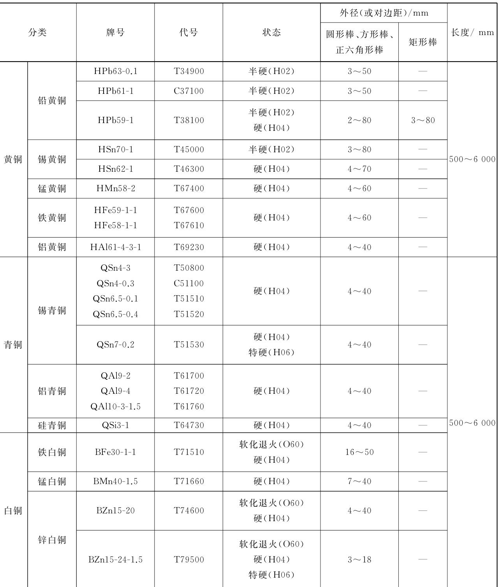
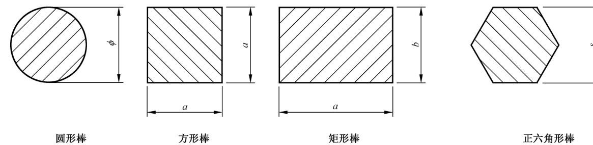
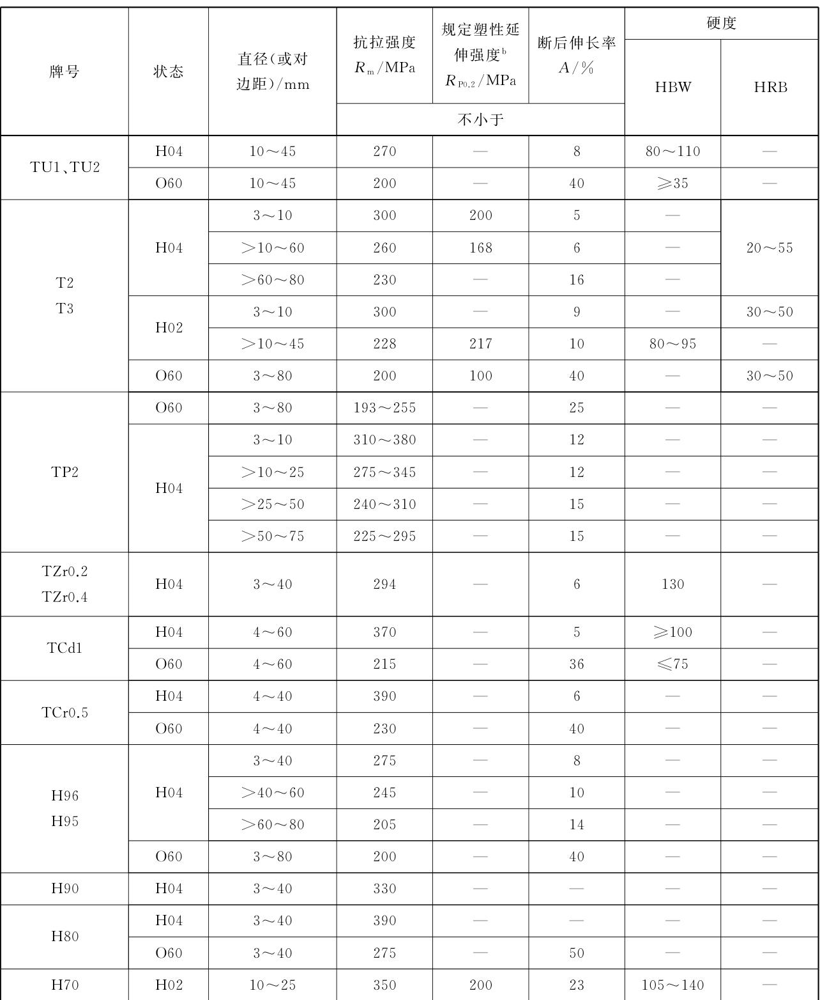
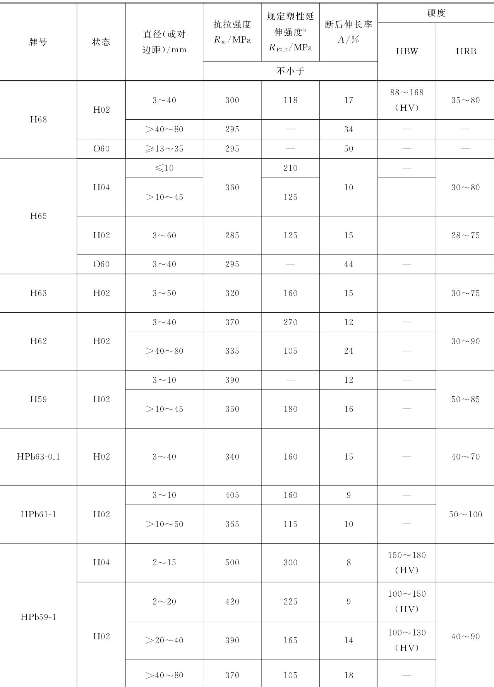
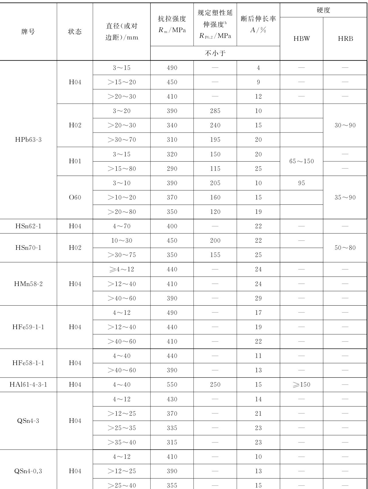
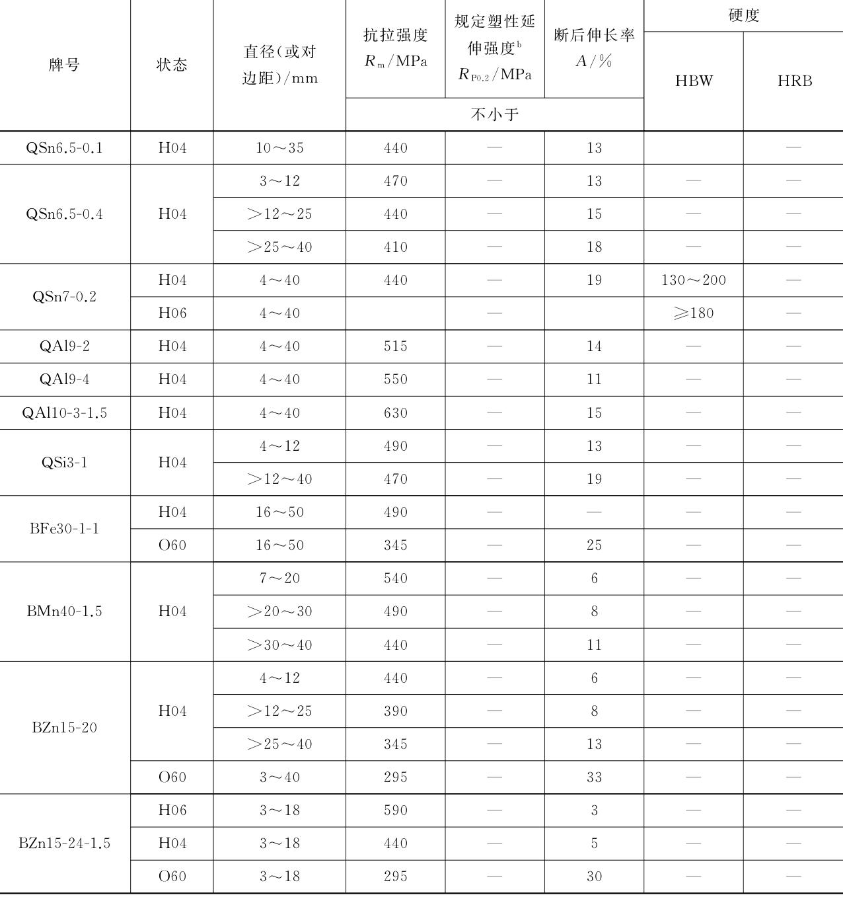

# 中华人民共和国国家标准 GB/T 4423—2020 代替GB/T4423—2007

Copper and copper alloy cold-drawn rod and bar 

2020-09-29发布

2021-08-01实施

国家市场监督管理总局发布国家标准化管理委员会

## 前言

本标准代替GB/T4423—2007《铜及铜合金拉制棒》，与GB/T4423—2007相比，主要技术变化如下：

修改了状态表示方法，增加了代号（见表1，2007年版的表1）；

增加了H59、H70、HSn70-1、HA161-4-3-1牌号，删除了QSi1.8牌号（见表1，2007年版的表1）；

增加了T2、T3半硬（H02）态，H65半硬（H02）态，HPb59-1硬（H04）态，HPb63-3软化退火（O60）和1/4硬（H01）态（见表1）；

删除了棒材不定尺长度的规定，增加了棒材长度的规定，范围为500mm～6000mm（见表1，2007年版的表1）；

修改了铜及黄铜类矩形棒材的允许偏差要求，与方形和正六角形棒材规定相同的允许偏差（见表4，2007年版的表4）；

修改了棒材的定尺或倍尺长度的允许偏差由十15mm变为十10mm（见4.2.3，2007年版的3.3.3);

将力学性能表中的布氏硬度修改为维氏硬度、洛氏硬度和布氏硬度三种，增加了规定塑性延伸强度要求（见表8、表9，2007年版的表7、表8）；

删除了氧含量要求（见2007年版的3.6）；

修改了棒材的外形尺寸测量方法（见5.2，2007年版的4.2）；

删除了附录A（见2007年版的附录A）。

## 本标准由中国有色金属工业协会提出。

本标准起草单位：浙江海亮股份有限公司、沈阳有色金属加工有限公司、中铝洛阳铜加工有限公司、宁波长振铜业有限公司、浙江天宁合金材料有限公司、宁波金田铜业（集团）股份有限公司、浙江省冶金产品质量检验站有限公司、宁波兴敖达金属新材料有限公司。

本标准主要起草人：魏连运、姜少军、董朝晖、周何滨、丁家圆、丁丙宏、赵万花、郭淑梅、王云岗、巢国辉、张洪、董艳霞、苏东东、郎滨、蒋洪赟、刘新伟、洪燮平、张宝、钱晓东、冯斌、黄敏。

本标准所代替标准的历次版本发布情况为：

GB/T 4423~4426—1984、GB/T 4427—1984、GB/T 4429~44331984;

GB/T 4423—1992、GB/T 13809—1992;

GB/T 4423—2007。

## 铜及铜合金拉制棒

## 1 范围

本标准规定了铜及铜合金拉制棒的分类和标记、技术要求、试验方法、检验规则、标志、包装、运输、贮存和质量证明书、订货单（或合同）内容。

本标准适用于一般用途的圆形、矩形、方形和正六角形铜及铜合金拉制棒材（以下简称棒材）。

## 2 规范性引用文件

下列文件对于本文件的应用是必不可少的。凡是注日期的引用文件，仅注日期的版本适用于本文件。凡是不注日期的引用文件，其最新版本（包括所有的修改单)适用于本文件。

GB/T231.1金属材料布氏硬度试验第1部分：试验方法

GB/T2828.1计数抽样检验程序第1部分：按接收质量限（AQL)检索的逐批检验抽样计划

GB/T3310铜及铜合金棒材超声波探伤方法

GB/T8888重有色金属加工产品的包装、标志、运输、贮存和质量证明书

GB/T10567.1铜及铜合金加工材残余应力检验方法硝酸亚汞试验法

GB/T10567.2铜及铜合金加工材残余应力检验方法氨薰试验法

GB/T26303.2铜及铜合金加工材外形尺寸检测方法第2部分：棒、线、型材

GB/T34505—2017铜及铜合金材料室温拉伸试验方法

YS/T668铜及铜合金理化检测取样方法

### 3.1 产品分类

<html><body><table border="1"><tr><td>短对边距/mm</td><td>长对边距/短对边距</td></tr><tr><td>≤10</td><td>≤2.0</td></tr><tr><td>>10~20</td><td>≤3.0</td></tr><tr><td>>20</td><td>≤3.5</td></tr></table></body></html>

### 3.2 产品标记

产品标记按产品名称、标准编号、牌号（或代号）、状态、精度级别和规格的顺序表示。棒材截面形状示意图见图1，标记示例如下：

说明：φ————直径；

长对边距；b————短对边距；s————对边距。

## 图1棒材截面形状示意图

示例1：用TP2（C12200）制造、供应状态为硬（H04）、普通级、直径为19mm、长度为3000mm的圆形铜棒标记为：圆形棒GB/T4423-TP2H04-19×3000

## 或圆形棒GB/T4423-T12200H04-19X3000

示例2：用H68（T26300）制造、供应状态为软化退火（O60）、高精级、对边距为10mm、长度为3000mm的方形铜棒标记为：

## 方形棒GB/T4423-H68O60高-10X3000

矩形棒GB/T4423-HPb63-3H01-20×13×1000

或矩形棒GB/T4423-T34700H01-20×13×1000

示例4：用HPb61-1（T37100）制造、供应状态为半硬态（H02）、高精级、对边距为30mm、长度为2000mm的正六角形铜棒标记为：

## 4 技术要求

### 4.1 化学成分

棒材H96牌号的化学成分应符合表3的规定，其他牌号的化学成分应符合GB/T5231的规定。

表3H96牌号的化学成分

<html><body><table border="1"><tr><td rowspan="2">牌号</td><td colspan="4">化学成分（质量分数）/%</td></tr><tr><td>Cu</td><td>Fe</td><td>Pb</td><td>Zn</td></tr><tr><td>H96a</td><td>95.0~97.0</td><td>≤0.10</td><td>≤0.03</td><td>余量</td></tr><tr><td colspan="5">aCu与所列元素的总和不小于99.8%。</td></tr></table></body></html>

### 4.2 尺寸及其允许偏差

#### 4.2.1 直径（或对边距）及其允许偏差

铜及黄铜类棒材直径(或对边距)及其允许偏差应符合表4的规定，青、白铜类棒材直径(或对边距）及其允许偏差应符合表5的规定。

<html><body><table border="1"><tr><td rowspan="2">直径（或对边距）</td><td colspan="2">圆形棒允许偏差</td><td colspan="2">方形、矩形、正六角形棒允许偏差</td></tr><tr><td>普通级</td><td>高精级</td><td>普通级</td><td>高精级</td></tr><tr><td>2~6</td><td>±0.04</td><td>±0.02</td><td>±0.07</td><td>±0.04</td></tr><tr><td>>6~10</td><td>±0.05</td><td>±0.03</td><td>±0.08</td><td>±0.04</td></tr><tr><td>>10~18</td><td>±0.06</td><td>±0.03</td><td>±0.10</td><td>±0.05</td></tr><tr><td>>18~30</td><td>±0.07</td><td>±0.04</td><td>±0.10</td><td>±0.06</td></tr><tr><td>>30~50</td><td>±0.10</td><td>±0.08</td><td>±0.13</td><td>±0.12</td></tr><tr><td>>50~80</td><td>±0.12</td><td>±0.10</td><td>±0.24</td><td>±0.15</td></tr></table></body></html>

表5青、白铜类棒材直径（或对边距）及其允许偏差

<html><body><table border="1"><tr><td rowspan="2">直径（或对边距）</td><td colspan="2">圆形棒允许偏差a</td><td colspan="2">方形、正六角形棒允许偏差</td><td colspan="2">矩形棒允许偏差</td></tr><tr><td>普通级</td><td>高精级</td><td>普通级</td><td>高精级</td><td>普通级</td><td>高精级</td></tr><tr><td>3~6</td><td>±0.06</td><td>±0.03</td><td>±0.10</td><td>±0.06</td><td>±0.15</td><td>±0.12</td></tr><tr><td>>6~10</td><td>±0.06</td><td>±0.04</td><td>±0.11</td><td>±0.08</td><td>±0.15</td><td>±0.12</td></tr><tr><td>>10~18</td><td>±0.08</td><td>±0.05</td><td>±0.13</td><td>±0.10</td><td>±0.18</td><td>±0.15</td></tr><tr><td>>18~30</td><td>±0.10</td><td>±0.06</td><td>±0.15</td><td>±0.10</td><td>±0.24</td><td>±0.20</td></tr><tr><td>>30~50</td><td>±0.10</td><td>±0.09</td><td>±0.16</td><td>±0.13</td><td>±0.38</td><td>±0.30</td></tr><tr><td>>50~80</td><td>±0.15</td><td>±0.12</td><td>±0.30</td><td>±0.24</td><td>±0.50</td><td>±0.40</td></tr></table></body></html>

a当要求直径（或对边距）允许偏差全为（十）或全为（一）单向偏差时，其值为表中相应数值的2倍。

GB/T 4423—2020

圆形棒材的圆度应不大于直径允许偏差之半。

#### 4.2.3 长度

棒材的不定尺长度为500mm～6000mm，定尺或倍尺长度应在不定尺范围内。定尺或倍尺长度的允许偏差为十10mm。倍尺长度应加入锯切分段时的锯切量，每一锯切量为5mm。

#### 4.2.4 扭拧度

方形、矩形和正六角形棒的扭拧度，按每300mm不应超过1°（精确到度），最大长度扭拧度不应超过15

#### 4.2.5 圆角半径

多边形棒材横截面的棱角处允许有圆角，其圆角半径应符合表6的规定。

<html><body><table border="1"><tr><td>对边距a</td><td>2~6</td><td>>6~10</td><td>>10~18</td><td>>18~30</td><td>>30~50</td><td>>50~80</td></tr><tr><td>圆角半径</td><td>≤0.5</td><td>≤0.8</td><td>≤1.2</td><td>≤1.8</td><td>≤2.8</td><td>≤4.0</td></tr><tr><td colspan="7">a矩形棒取短对边距。</td></tr></table></body></html>

#### 4.2.6 直度

## 表7棒材的直度

<html><body><table border="1"><tr><td colspan="2">直径（或对边距）</td><td>长度</td><td>最大弧深</td></tr><tr><td rowspan="4">圆形</td><td rowspan="2"><6.35</td><td>1000~3000</td><td>1.5（在任何1000mm长度上）</td></tr><tr><td>>3000</td><td>12（在任何3000mm长度上）</td></tr><tr><td rowspan="2">≥6.35</td><td>1000~3000</td><td>2（在任何1000mm长度上）</td></tr><tr><td>>3 000</td><td>6.35（在任何3000mm长度上）</td></tr><tr><td rowspan="4">正方形、 矩形、正 六角形</td><td rowspan="2"><6.35</td><td>1000~3 000</td><td>4（在任何1000mm长度上）</td></tr><tr><td>>3 000</td><td>12.7（在任何3000mm长度上）</td></tr><tr><td rowspan="2">≥6.35</td><td>1000~3 000</td><td>3（在任何1000mm长度上）</td></tr><tr><td>>3000</td><td>9.5（在任何3000mm长度上）</td></tr></table></body></html>

#### 4.2.7 倒角

棒材端部可倒角，具体要求由供需双方协商确定。

#### 4.2.8 切斜度

### （或长对边距)的2.5%。

### 4.3 力学性能

棒材的室温力学性能应符合表8和表9的规定。

a表中“—”提供实测值。b此值仅供参考。

<html><body><table border="1"><tr><td rowspan="2">牌号</td><td rowspan="2">状态</td><td rowspan="2">直径（或对 边距)/mm</td><td rowspan="2">抗拉强度 Rm /MPa</td><td rowspan="2">规定塑性延 伸强度b R p0.2 / MPa</td><td rowspan="2">断后伸长率 A/%</td><td colspan="2">硬度</td></tr><tr><td>HBW</td><td>HRB</td></tr><tr><td rowspan="2">不小于</td><td></td><td></td><td></td><td></td><td></td><td></td><td></td></tr><tr><td>T2</td><td>060</td><td>3~80</td><td>196</td><td></td><td>36</td><td></td></tr><tr><td rowspan="2">H04</td><td rowspan="2">3~80</td><td>245</td><td></td><td>9</td><td></td><td></td><td></td></tr><tr><td>H62</td><td>H02</td><td>3~20</td><td>335</td><td></td><td>17</td></tr><tr><td rowspan="2">>20~80</td><td rowspan="2">335</td><td></td><td>23</td><td></td><td></td><td></td><td></td></tr><tr><td>HPb59-1</td><td>H02</td><td>2~50</td><td>390</td><td></td><td>12</td></tr><tr><td rowspan="2">>50~80</td><td rowspan="2">375</td><td></td><td>18</td><td></td><td></td><td></td><td></td></tr><tr><td>HPb63-3</td><td>H02</td><td>3~20</td><td>380</td><td></td><td>14</td></tr><tr><td colspan="8">a表中“—”提供实测值。</td></tr></table></body></html>

### 4.4 内部质量

除TU1、TU2、T2、T3、TP2、TCr0.5、H96、H95以外，其他合金棒材应进行断口或超声波探伤检验。

棒材断口应致密、无缩尾。不应有超出YS/T336中规定的气孔、分层和夹杂等缺陷。超声波探伤试验结果应符合GB/T3310的要求。

### 4.5 残余应力

H01、H02、H04、H06态的黄铜（H96、H95除外）、锡青铜、硅青铜和锌白铜棒材可进行残余应力检验，检验结果不应有肉眼可见的裂纹。

### 4.6 表面质量

棒材表面应光亮、清洁，不应有影响使用的缺陷。

## 5 试验方法

### 5.1 化学成分

棒材的化学成分分析方法应按GB/T5121、YS/T482或YS/T483的规定进行，仲裁时按GB/T5121的规定进行。

### 5.2 外形尺寸及其允许偏差

棒材的外形尺寸测量方法按GB/T26303.2的规定进行。

GB/T 4423—2020

5.3.1棒材的室温拉伸试验及其试样制备方法按GB/T34505一2017的规定进行，试样的选取应符合表10的规定。

表10拉伸试样类型的选取

<html><body><table border="1"><tr><td>直径（或对边距）/mm</td><td>试样类型的选取</td></tr><tr><td>≤12.5</td><td>GB/T34505—2017表11中全截面试样</td></tr><tr><td>>12.5~15</td><td>GB/T34505—2017表11中试样号R2</td></tr><tr><td>>15</td><td>GB/T34505—2017表11中试样号R1</td></tr></table></body></html>

5.3.2棒材的布氏硬度试验按GB/T231.1的规定进行。

5.3.3棒材的维氏硬度试验按GB/T4340.1的规定进行。

5.3.4棒材的洛氏硬度试验按GB/T230.1的规定进行。

### 5.4 内部质量

5.4.1棒材的断口检验按YS/T336的规定进行。

5.4.2棒材的超声波探伤检验按GB/T3310的规定进行。

### 5.5 残余应力

棒材残余应力检验按GB/T10567.1和GB/T10567.2的规定进行。

### 5.6 表面质量

棒材的表面质量用目视进行检验。

## 6 检验规则

### 6.1 检查和验收

6.1.1棒材应由供方技术监督部门进行检验，保证产品质量符合本标准的规定，并填写质量证明书。6.1.2需方应对收到的产品按本标准的规定进行检验。如检验结果与本标准（或订货合同)的规定不符时，应在收到产品之日起1个月内向供方提出，由供需双方协商解决。如需仲裁，仲裁取样应双方共同进行。

### 6.2 组批

### 6.3 检验项目

#### 6.3.1 每批棒材应进行化学成分、外形尺寸及其允许偏差、内部质量和表面质量的检验。

6.3.2每批棒材应进行力学性能（拉伸试验或硬度试验）检验。拉伸试验和硬度试验任选其一，未在合同中注明时，进行拉伸试验。当选择拉伸试验时，如需方还要求硬度试验并在合同中注明时，还应进行硬度试验，硬度试验结果仅供参考；当选择硬度试验时，如需方还要求拉伸试验并在合同中注明时，还应进行拉伸试验，拉伸试验结果仅供参考。

6.3.3需方有要求时，还应进行残余应力检验。

### 6.4 取样

产品取样应符合表11的规定。取样方法按YS/T668的规定进行。

## 表11取样

<html><body><table border="1"><tr><td colspan="2">检验项目</td><td>取样规定</td><td>要求章 节号</td><td>试验方法章节号</td></tr><tr><td colspan="2">化学成分</td><td>供方每炉取1个试样；需方每批取1个试样</td><td>4.1</td><td>5.1</td></tr><tr><td colspan="2">外形尺寸及其允许偏差</td><td>按照GB/T2828.1的规定取样，选择正常检验一次抽 样方案，一般检测水平Ⅱ，接收质量限AQL=2.5，或 供需双方协商</td><td>4.2</td><td>5.2</td></tr><tr><td colspan="2">力学性能</td><td>每批任选2根，每根取1个试样</td><td>4.3</td><td>5.3</td></tr><tr><td rowspan="2">内部质量</td><td>断口</td><td>每批任选2根，每根取1个试样</td><td rowspan="2">4.4</td><td rowspan="2">5.4</td></tr><tr><td>超声波探伤</td><td>逐根</td></tr><tr><td colspan="2">残余应力</td><td>任取2根/批，1个试样/根</td><td>4.5</td><td>5.5</td></tr><tr><td colspan="2">表面质量</td><td>按照GB/T2828.1的规定取样，选择正常检验一次抽 样方案，一般检测水平Ⅱ，接收质量限AQL=2.5，或 供需双方协商</td><td>4.6</td><td>5.6</td></tr></table></body></html>

### 6.5 检验结果的判定

6.5.1检验结果的数值按GB/T8170的规定进行修约，并采用修约值比较法判定。

6.5.3棒材外形尺寸及其允许偏差和表面质量不合格时，按根判不合格。每批中不合格件数超出接受质量限时判整批不合格，或由供方逐根检验，合格者交货。

6.5.4当力学性能、断口、残余应力试验结果中有试样不合格时，应从该批产品中（包括原检验不合格的那根)再取双倍数量的试样进行该不合格项目的重复试验。如重复试验结果全部合格，则判整批产品合格。若重复试验结果仍有试样不合格，则判该批产品不合格，或由供方逐根检验，合格者交货。

6.5.5当超声波探伤检验不合格时，按根判不合格。

#### 6.5.6 当出现其他缺陷时，由供需双方协商确定。

## 7 标志、包装、运输、贮存和质量证明书

产品的标志、包装、运输、贮存和质量证明书应符合GB/T8888的规定。

## 8 订货单（或合同）内容

本标准所列棒材的订货单（或合同）应包括下列内容：

a）产品名称；

b）牌号（或代号）；

c）状态；

GB/T 4423—2020

d)规格；e)精度等级（普通级或高精级）；f)重量或根数；g)拉伸试验和硬度试验的选择；h)残余应力（有需要时）；i)本标准编号；j)其他。